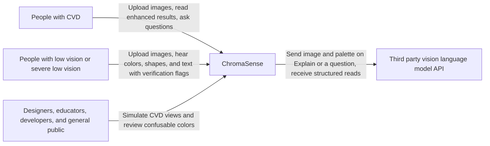
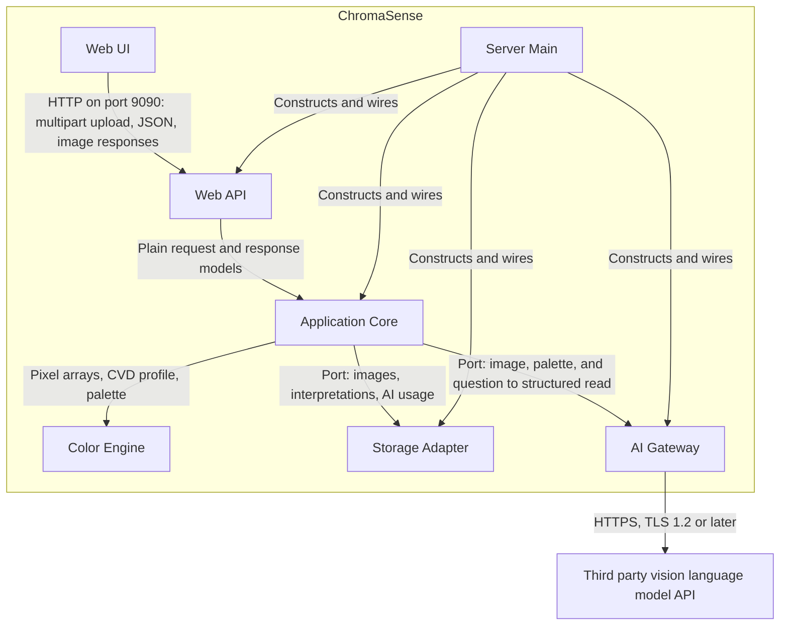

# Architecture

You fill this file in stage 2 (see `README.md`).

Do not list prompt filenames here. Do not repeat requirements. When a decision satisfies a requirement, cite its `SRS-FR-` or `SRS-NFR-` ID.

## Required: Context

The C4 context view: the people and external systems around this software. If a node does not exist, delete it.

## Required: Containers

The C4 container view: the main runnable or deployable parts, and how they call each other. Use one node for each part in the list below.

Everything except the Web UI runs in one Docker container. Arrows show runtime calls. Storage Adapter and AI Gateway are called through ports that Application Core owns, so their source dependencies point inward.

## Required: Parts

Name each major part and its job. The agent must not add a part that is not in this list.

- **Web UI**: Pages, styles, and browser scripts that the server delivers. Holds the CVD profile and speech settings in browser storage, plays speech, and announces results to screen readers. Sends clicks and keyboard moves as coordinates and does no pixel processing.
- **Web API**: Humble HTTP adapter. Serves the pages and REST endpoints, assigns an anonymous session ID, checks request shape, maps requests to use case calls, and maps results and errors to responses.
- **Application Core**: Use cases and the policy they need, organized by application action: process upload, reanalyze for profile, render view, identify color, export, interpret image, answer question, and purge expired data. Runs the pipeline, validates and verifies AI items, enforces rate limits and the spend cap, and owns the ports for storage, AI, and the clock.
- **Color Engine**: Separate, installable Python package of pipeline filters and color rules: decode, sRGB conversion, downscale, CVD simulation, palette extraction, CIEDE2000 distance, confusion detection, masking, enhancement, pattern overlays, and color naming from the bundled dataset.
- **Storage Adapter**: Implements the storage ports. Keeps temporary images on the filesystem, and keeps cached interpretations and AI usage in SQLite.
- **AI Gateway**: Implements the AI port. Holds the provider API key, builds the provider request, enforces HTTPS and TLS 1.2 or later, and maps the provider's response or failure to plain core models. It is the only part that calls the provider.
- **Server Main**: Composition root. Reads configuration, constructs the parts and wires them together, starts the server on port 9090, and schedules the purge of expired data.

## Optional: Classes and functions

The basic contracts inside each part. The agent may add private helpers and small data classes inside a part, but must keep these names.

### Naming rule

Only Pipe and Filter pipeline code is numbered, and the number is its position in the pipeline. Everything required by Clean Architecture (use cases, ports, adapters, storage, Docker, and wiring) and every shared color rule stays unnumbered. Python names cannot start with a digit or contain a hyphen, so the number follows a word:

- Directory: `filter_<N>_<name>`
- Function: `<name>_<N>`
- Output class: `<Name><N>`

### Pipeline filters (Color Engine)

| N | Directory | Function | Output class | SRS IDs |
| --- | --- | --- | --- | --- |
| 1 | `filter_1_decode` | `decode_1(data: bytes)` | `DecodedImage1` | SRS-FR-004, SRS-FR-005, SRS-FR-007 |
| 2 | `filter_2_downscale` | `downscale_2(image: DecodedImage1, max_megapixels: float)` | `AnalysisImage2` | SRS-FR-006 |
| 3 | `filter_3_palette` | `extract_palette_3(pixels: NDArray, color_count: int)` | `Palette3` | SRS-FR-022 |
| 4 | `filter_4_confusion` | `detect_confusion_4(pixels: NDArray, palette: Palette3, profile: CvdProfile, threshold: float)` | `ConfusionResult4` | SRS-FR-023, SRS-FR-024, SRS-FR-025 |
| 5 | `filter_5_enhance` | `enhance_5(pixels: NDArray, confusion: ConfusionResult4, strength: float)` | `EnhancedImage5` | SRS-FR-028, SRS-FR-029, SRS-FR-031 |

The use cases run the filters in these orders:

- **Upload with a CVD type**: 1, 2, 3, 4, 5, then 3 and 4 again on the enhanced pixels to count remaining pairs (SRS-FR-008, SRS-FR-030)
- **Upload with no CVD**: 1, 2, 3 (SRS-FR-054)
- **Profile change**: 4, 5, then 3 and 4 again on the enhanced pixels, using the stored palette for the first 4 (SRS-FR-014)
- **Export**: 4 and 5 on the original pixels with the stored palette (SRS-FR-041)

### Color rules (Color Engine, unnumbered)

Filters and use cases may call these. They are not pipeline stages.

- `CvdType` (enum: `PROTAN`, `DEUTAN`, `TRITAN`, `ACHROMATOPSIA`, `NONE`), `CvdProfile` (`type`, `severity`), `ColorInfo` (`name`, `hex`, `rgb`, `hsl`, `family`)
- `srgb_to_linear(pixels)`, `linear_to_srgb(pixels)`
- `simulate(pixels, profile)`
- `ciede2000(lab_a, lab_b)`
- `ColorNamer.describe(rgb) -> ColorInfo`
- `apply_overlay(pixels, mask, groups)`

### Ports (Application Core)

Each port is a `typing.Protocol`.

- `ImageStore`: `save(record, original, working)`, `load(image_id)`, `save_analysis(image_id, analysis)`, `delete_expired(now)`
- `InterpretationCache`: `get(image_hash, now)`, `put(interpretation)`, `delete_expired(now)`
- `AiUsageLedger`: `record(session_id, ip_address, estimated_cost, now)`, `usage(session_id, ip_address, now)`, `total_cost(now)`
- `VisionReader`: `read(image, palette) -> AiRead`, `ask(image, palette, items, question) -> AiAnswer`
- `Clock`: `now()`

### Use cases (Application Core)

Each use case is one class with `execute(request) -> response`, using plain dataclasses for both.

- `ProcessUpload`, `ReanalyzeForProfile`, `RenderView`, `IdentifyColor`, `ExportImage`, `InterpretImage`, `AnswerQuestion`, `PurgeExpired`

### Core models and policy (Application Core)

- Models: `ImageRecord`, `ImageAnalysis`, `Interpretation`, `AiRead`, `AiAnswer`, `LegendEntry`, `TextItem`, `ShapeItem`, `ColorItem`, `Verification` (enum: `VERIFIED`, `UNVERIFIED`)
- `validate_legend(entries, palette)`
- `verify_items(first: AiRead, second: AiRead, palette)`
- `verify_answer(answer, interpretation)`
- `AiLimits.check(usage)`

### Adapters and wiring (unnumbered)

- **Storage Adapter**: `FilesystemImageStore`, `SqliteInterpretationCache`, `SqliteAiUsageLedger`
- **AI Gateway**: `HttpVisionReader`
- **Web API**: `create_app(use_cases, ...)`, routers `pages_router`, `images_router`, and `ai_router`, and Pydantic request and response schemas
- **Server Main**: `Settings`, `SystemClock`, `build_app(settings)`, `main()`

## Required: Stack

Language, runtime, frameworks, and build tool.

- **Language and runtime**: Python 3.11 in a Docker container, with Docker Compose and a committed dev container for development
- **Web**: FastAPI on Uvicorn, with python-multipart for uploads, Jinja2 server-rendered pages, and plain JavaScript and CSS, with no JavaScript build step
- **Imaging and color**: NumPy, Pillow with pillow-heif for HEIC, scikit-image for CIELAB and CIEDE2000, and scikit-learn for k-means
- **AI**: httpx for provider calls, behind the AI port. The provider is set in configuration and has not been chosen.
- **Storage**: Local filesystem and SQLite through the Python standard library, on a Docker volume
- **Speech**: The browser's Web Speech API
- **Build and packaging**: `pyproject.toml` for each Python package, installed with pip in the Docker image build
- **Quality**: pytest and pytest-cov, DaltonLens as a test-only reference, Ruff for linting and formatting, import-linter for dependency rules, Playwright with axe-playwright-python for browser tests, and GitHub Actions for required pull request checks

## Required: Hard constraints

Rules that the agent must not break. Examples: a required library, a required format, work that is forbidden even if an SRS row could permit it.

- Source dependencies point inward: Web API, Storage Adapter, AI Gateway, and Server Main may import Application Core; Application Core may import Color Engine; neither may import an outer part. CI enforces this with import-linter. (SRS-NFR-029)
- Color Engine imports only its imaging and color libraries and the standard library. It makes no network calls and reads no environment variables. (SRS-NFR-020, SRS-NFR-027, SRS-NFR-032)
- Application Core imports no FastAPI, SQLite, httpx, or provider code, and its tests run with fakes for every port.
- Web API, Storage Adapter, and AI Gateway hold no business rules. Color decisions, AI item verification, rate limits, and the spend cap belong in Color Engine or Application Core.
- Only Color Engine processes pixels, on the server. The Web UI must not compute colors, names, or simulations in the browser.
- The API key is read only by Server Main and used only by AI Gateway. It never appears in a response, page, script, or log. (SRS-NFR-007)
- Add no text recognition library, machine learning segmentation, or image type classifier. Text and shape items come only from the vision language model.
- A color's name and values always come from Color Engine, never from AI text. (SRS-FR-058)
- Add no message queue, separate worker service, external database, account system, or second web framework.
- Each filter takes plain data and returns plain data, and no filter calls another filter. Only the Application Core use case decides the order.

## Required: Decisions

Record one to three decisions that you already made. Delete the unused decision blocks. The agent must follow these decisions and must not invent a competing architecture.

### Decision 1

- **Context**: ChromaSense's color rules must stay testable and replaceable while the web framework, storage, and AI provider may change. An upload also needs to run through a fixed sequence of image processing stages.
- **Decision**: Use Clean Architecture (Robert C. Martin) for the overall structure, and Pipe and Filter for the processing pipeline. Source dependencies point inward, so the color rules and use cases do not import the web framework, storage, or AI provider. A use case runs the pipeline as a one-way sequence of independent filters: decode, downscale, palette extraction, confusion detection, and enhancement. With no CVD selected, the use case stops after palette extraction. AI interpretation is a separate use case and is not a pipeline filter.
- **Rejected**: A framework-centered design with pipeline logic in web request handlers, because it would tie the color rules to the framework and make them harder to test and reuse.
- **SRS IDs**: SRS-FR-008, SRS-FR-054, SRS-NFR-027, SRS-NFR-028, SRS-NFR-029, SRS-NFR-030, SRS-NFR-032

### Decision 2

- **Context**: A team of three must deliver a portal that works by keyboard and screen reader, and with no view of the screen. It must also load quickly on a LAN and speak results without a browser permission prompt.
- **Decision**: Render pages on the server with semantic HTML, and add plain JavaScript only for uploads, sliders, the keyboard color point, live announcements, and speech. Speak results in the browser with the Web Speech API, so spoken color results still work when the server has no internet connection and audio never crosses the server.
- **Rejected**: A single-page application framework, because it adds a build step and a second language stack, and makes focus and announcement behavior harder to keep correct. Server-side text to speech, because it adds a dependency, cost, and latency, and may need the internet.
- **SRS IDs**: SRS-FR-052, SRS-FR-062, SRS-FR-063, SRS-NFR-005, SRS-NFR-012, SRS-NFR-020, SRS-NFR-036, SRS-NFR-038

### Decision 3

- **Context**: Users who can hardly see cannot check AI results by eye, so each item needs a trustworthy flag. Pixels can confirm colors, but text recognition is out of scope, so nothing independent can confirm text and shapes.
- **Decision**: One Explain makes two concurrent, separate provider requests, and neither sees the other's output. AI Gateway returns each read as plain items, and Application Core compares them. A text item is verified when both reads match after normalizing case and whitespace. A shape item is verified when both reads give the same kind and palette ID. A color item is verified by its palette ID, and Color Engine supplies its name and values. A follow up answer is verified only when every item it cites is verified. Both requests count toward the rate limit and spend cap, and the cached interpretation stores the final flags.
- **Rejected**: Showing the first read to the second request, because it would bias the second read toward agreement. Marking all text and shape items unverified, because it would give these users no signal. Adding text recognition, because the SRS rules it out for this release.
- **SRS IDs**: SRS-FR-043, SRS-FR-044, SRS-FR-047, SRS-FR-055, SRS-FR-056, SRS-FR-057, SRS-FR-058, SRS-FR-059, SRS-FR-060, SRS-NFR-004, SRS-NFR-010, SRS-NFR-011, SRS-NFR-040

## Required: Primary design rule

During implementation, the agent may read one book rule file. That file biases how the agent writes code inside the boundaries above. It is not a second architecture.

Write one path that ends in `.mini.md`, or write `none`. Do not list two books. Example: `user resources/agent-rules-books/clean-code/clean-code.mini.md`.

Before you select, read `user resources/HOW-TO-agent-rules-books.md` and `user resources/ARCHITECTURE-NOTES.md`.

clean-architecture.mini.md
