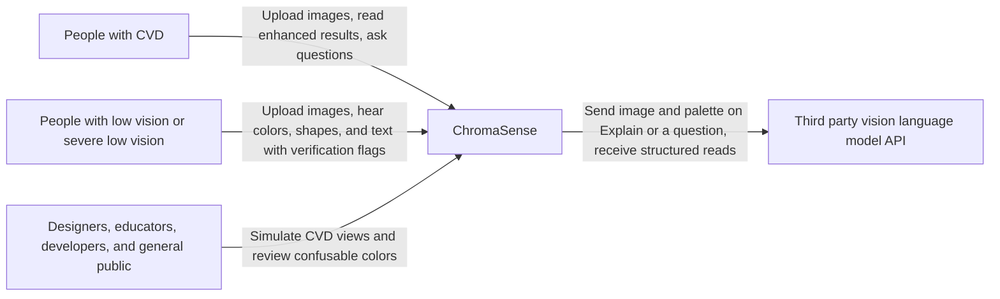
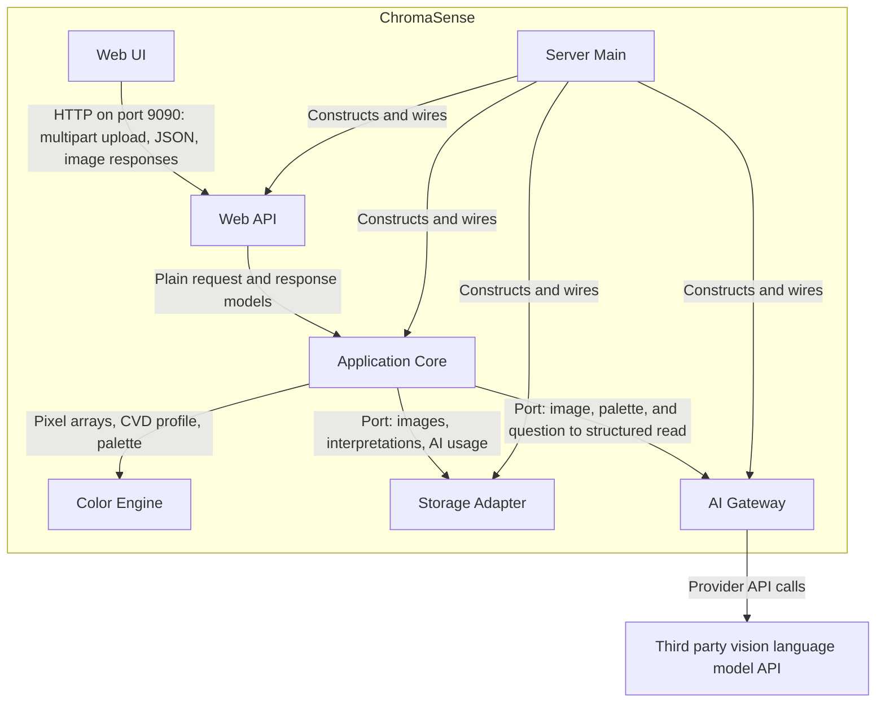

# Prompt 0: ChromaSense master context

Reload this file at the start of each implementation session. It is not an implementation step.

### Main rules

- Build only ChromaSense: AI Powered Color Accessibility Web Portal, as `srs.md`, `architecture.md`, and `structure.md` define it.
- Do not add a requirement, part, screen, folder, operation, or behavior that those files do not name.
- Follow `implementation-guide.md`. Run the increments in filename order, and update `prompts/tracking.md` after each.
- When this file and a user file disagree, the user file wins. Stop and report the contradiction.
- A name marked `derived` in an increment did not come from the user. It is the smallest interface that satisfies the cited requirement.

### How paths work

- The user files and this folder live in `dev/`. In these prompts, `srs.md` means `dev/srs.md`, and `prompts/` means `dev/prompts/`.
- The tree root `ChromaSense/` in `structure.md` is the repository root. Run every command from the repository root.
- The primary design rule is `dev/clean-architecture.mini.md`. Read that one file during implementation. Do not paste it into a prompt, and do not open a second book.

## 1. Domain background

### Purpose

This specification is for Team BlindSpot, the course instructor, testers, and the agents that generate and implement the build. The build must satisfy the requirements below, and every `must` verification must hold.

### Scope

ChromaSense is a server-side web portal, reached from a browser on the local network, that helps people with color vision deficiency (CVD) and low vision understand color coded information in images. Unlike a global color filter, it detects which colors are confusable for a specific user's CVD profile, enhances only those colors, and uses AI to explain the meaning of color coded content such as charts, maps, and legends. It presents analysis results in accessible text and can speak AI responses so users do not have to rely on seeing colors, shapes, or text. Local computer vision and text recognition analyze each image at upload, without the AI service, and AI adds interpretation when the user asks for it. For users who can hardly see, it identifies the colors, shapes, and text in an image and reports whether each item was verified. It also includes a CVD simulator for people with typical color vision who want to review their content. Uploading an image starts the processing pipeline. Charts, maps, and flat graphics are the supported target for this release, and photographs are handled on a best effort basis.

### Product perspective

ChromaSense is a new, self contained product and is not part of a larger system. Users reach it with a web browser on a computer or phone on the same LAN as the server host. It has one external system: a third party vision language model (VLM) API, which only the server calls and which is needed only for AI interpretation.

### Users

- Users with CVD (varying CVD type and severity, general web browsing skills) — make color coded images readable through enhancement, overlays, color identification, and the AI interpreter
- Students and professionals with CVD (frequently read charts, maps, and dashboards) — understand charts and maps through the AI interpreter, follow up questions, and overlays
- People with low vision (general web browsing skills; may use magnification, a screen reader, or speech output) — access color, pattern, and AI interpretation results without relying on visual-only cues
- People with severe low vision (can hardly see the screen, may have no CVD, use a screen reader or keyboard to browse the web) — have any color, shape, or text in an image identified and verified, and hear the results through a screen reader or spoken AI responses
- Designers, educators, and developers (typical color vision, produce visual content) — test how their content appears to CVD users with the simulator and confusion detection
- General public (general web browsing skills, curious about CVD) — see how images appear under each CVD type with the simulator

### Product functions

- Upload images from a file picker, by drag and drop, or from the clipboard, which starts the pipeline
- Select a CVD profile with type and severity, or state that the user has no CVD
- Simulate how an image appears to each CVD type
- Detect confusable color pairs for the active profile
- Enhance only confusable colors
- Add pattern overlays to confusable colors
- Identify the name and values of a color at a point chosen by click, tap, or keyboard
- Browse detected colors and confusable pairs through accessible text, including their color values and pattern labels
- Interpret charts and maps with AI and answer typed user questions
- Find the regions, shapes, text, legend, and image type in an image locally at upload, without the AI service
- Check text and shape items by comparing one AI read with the local analysis, and report whether each color, shape, and text item was verified
- Read AI responses, local analysis results, and color identification results aloud with user-controlled speech playback
- Download enhanced images

### Assumptions and dependencies

- A third party vision language model API remains available at an acceptable cost
- The server has an internet connection for AI interpretation
- The host firewall and network allow other LAN devices to reach port 9090
- Users have a current version of Chrome, Edge, Firefox, or Safari
- Users who rely on a screen reader supply their own, and the browser supplies the speech voices used for spoken playback
- Display color accuracy depends on device settings such as brightness and color temperature filters
- Published CVD simulation models are sufficiently accurate for the purposes of this application
- Local text recognition reads English text in this release, and small or rotated text may not be recognized
- Each developer can install and run Docker on their machine

### Out of scope

The agent must not add any of these behaviors.

- Native mobile applications
- Browser extensions
- Live camera mode and other video processing
- Personal calibration test or severity estimation
- User accounts, sign in, account deletion, and profile sync across devices
- Access from outside the LAN
- Medical diagnosis of CVD
- Offline operation of the portal
- A setting for a default enhancement method or overlay style
- Segmenting images with a machine learning model
- Placing legend labels directly on chart regions
- Identifying the average color of a brushed region
- Sharing other than by browser download
- Image type classification with a trained model
- A confirmation step before sending an image to the AI service, because AI runs only when the user clicks Explain
- A privacy notice or browser permission prompts
- Spoken input for questions
- Any guarantee that a verified item is correct, or use of results for medical, medication, or safety decisions

### Logical data

- CVD profile: the CVD type or no CVD, severity, and time of last update, kept in the user's browser
- Speech settings: the speech rate and the automatic reading setting, kept in the user's browser
- Temporary image: the uploaded original, its working copy, a hash that identifies the image, and its creation and expiry times, kept on the server for 24 hours by default
- Local analysis: the regions, shapes, text, legend, and image type of a temporary image, kept and expired with that image
- Interpretation: the image hash, summary, legend mapping, text and shape items, verification flags, and creation time, cached on the server for 30 days
- AI usage: the request count and estimated cost for each period and browser session, kept on the server
- Named color: the name, HEX value, CIELAB values, and basic color family of each color in the dataset bundled with the server

## 2. Architecture overview

### Context



### Containers

Everything except the Web UI runs in one Docker container. Arrows show runtime calls. Storage Adapter and AI Gateway are called through ports that Application Core owns, so their source dependencies point inward.



### Parts

The agent must not add a part that is not in this list.

- **Web UI**: Pages, styles, and browser scripts that the server delivers. Holds the CVD profile and speech settings in browser storage, plays speech, and announces results to screen readers. Sends clicks and keyboard moves as coordinates and does no pixel processing.
- **Web API**: Humble HTTP adapter. Serves the pages and REST endpoints, assigns an anonymous session ID, checks request shape, maps requests to use case calls, and maps results and errors to responses.
- **Application Core**: Use cases and the policy they need, organized by application action: process upload, get analysis, reanalyze for profile, render view, identify color, export, interpret image, answer question, and purge expired data. Runs the pipeline, validates and verifies AI items, enforces rate limits and the spend cap, and owns the ports for storage, AI, and the clock.
- **Color Engine**: Separate, installable Python package of pipeline filters and color rules: decode, sRGB conversion, downscale, palette extraction, region labeling, shape detection, local text recognition, layout analysis (image type and legend), CVD simulation, CIEDE2000 distance, confusion detection, masking, enhancement, pattern overlays, and color naming from the bundled dataset.
- **Storage Adapter**: Implements the storage ports. Keeps temporary images on the filesystem, and keeps cached interpretations and AI usage in SQLite.
- **AI Gateway**: Implements the AI port. Holds the provider API key, builds the provider request, and maps the provider's response or failure to plain core models. It is the only part that calls the provider.
- **Server Main**: Composition root. Reads configuration, constructs the parts and wires them together, starts the server on port 9090, and schedules the purge of expired data.

### Classes and functions

The agent may add private helpers and small data classes inside a part, but must keep these names.

#### Naming rule

Only Pipe and Filter pipeline code is numbered, and the number is its position in the pipeline. Everything required by Clean Architecture (use cases, ports, adapters, storage, Docker, and wiring) and every shared color rule stays unnumbered. Python names cannot start with a digit or contain a hyphen, so the number follows a word:

- Directory: `filter_<N>_<name>`
- Function: `<name>_<N>`
- Output class: `<Name><N>`

#### Pipeline filters (Color Engine)

| N | Directory | Function | Output class | SRS IDs |
| --- | --- | --- | --- | --- |
| 1 | `filter_1_decode` | `decode_1(data: bytes)` | `DecodedImage1` | SRS-FR-004, SRS-FR-005, SRS-FR-007 |
| 2 | `filter_2_downscale` | `downscale_2(image: DecodedImage1, max_megapixels: float)` | `AnalysisImage2` | SRS-FR-006 |
| 3 | `filter_3_palette` | `extract_palette_3(pixels: NDArray, color_count: int)` | `Palette3` | SRS-FR-022 |
| 4 | `filter_4_regions` | `find_regions_4(pixels: NDArray, palette: Palette3)` | `RegionMap4` | SRS-FR-065 |
| 5 | `filter_5_shapes` | `find_shapes_5(regions: RegionMap4)` | `ShapeSet5` | SRS-FR-056 |
| 6 | `filter_6_text` | `read_text_6(pixels: NDArray)` | `TextSet6` | SRS-FR-055 |
| 7 | `filter_7_layout` | `analyze_layout_7(pixels: NDArray, palette: Palette3, regions: RegionMap4, text: TextSet6)` | `LayoutResult7` | SRS-FR-066, SRS-FR-067 |
| 8 | `filter_8_confusion` | `detect_confusion_8(pixels: NDArray, palette: Palette3, profile: CvdProfile, threshold: float)` | `ConfusionResult8` | SRS-FR-023, SRS-FR-024, SRS-FR-025 |
| 9 | `filter_9_enhance` | `enhance_9(pixels: NDArray, confusion: ConfusionResult8, strength: float)` | `EnhancedImage9` | SRS-FR-028, SRS-FR-029, SRS-FR-031 |

The use cases run the filters in these orders:

- **Upload with a CVD type**: 1, 2, 3, 4, 5, 6, 7, 8, 9, then 3 and 8 again on the enhanced pixels to count remaining pairs (SRS-FR-008, SRS-FR-030)
- **Upload with no CVD**: 1, 2, 3, 4, 5, 6, 7 (SRS-FR-054)
- **Profile change**: 8, 9, then 3 and 8 again on the enhanced pixels, using the stored palette for the first 8. Filters 4 to 7 do not depend on the profile and do not run again (SRS-FR-014)
- **Export**: 8 and 9 on the original pixels with the stored palette (SRS-FR-041)

Each filter can be tested on its own, and `GetAnalysis` exposes the stored results of filters 4 to 7 with no AI provider configured (SRS-FR-070).

#### Color rules (Color Engine, unnumbered)

Filters and use cases may call these. They are not pipeline stages.

- `CvdType` (enum: `PROTAN`, `DEUTAN`, `TRITAN`, `ACHROMATOPSIA`, `NONE`), `CvdProfile` (`type`, `severity`), `ColorInfo` (`name`, `hex`, `rgb`, `hsl`, `family`)
- `srgb_to_linear(pixels)`, `linear_to_srgb(pixels)`
- `simulate(pixels, profile)`
- `ciede2000(lab_a, lab_b)`
- `ColorNamer.describe(rgb) -> ColorInfo`
- `apply_overlay(pixels, mask, groups)`

#### Ports (Application Core)

Each port is a `typing.Protocol`.

- `ImageStore`: `save(record, original, working)`, `load(image_id)`, `save_analysis(image_id, analysis)`, `delete_expired(now)`
- `InterpretationCache`: `get(image_hash, now)`, `put(interpretation)`, `delete_expired(now)`
- `AiUsageLedger`: `record(session_id, ip_address, estimated_cost, now)`, `usage(session_id, ip_address, now)`, `total_cost(now)`
- `VisionReader`: `read(image, palette, image_type) -> AiRead`, `ask(image, palette, items, question) -> AiAnswer`
- `Clock`: `now()`

#### Use cases (Application Core)

Each use case is one class with `execute(request) -> response`, using plain dataclasses for both.

- `ProcessUpload`, `GetAnalysis`, `ReanalyzeForProfile`, `RenderView`, `IdentifyColor`, `ExportImage`, `InterpretImage`, `AnswerQuestion`, `PurgeExpired`

#### Core models and policy (Application Core)

- Models: `ImageRecord`, `ImageAnalysis`, `Interpretation`, `AiRead`, `AiAnswer`, `LegendEntry`, `TextItem`, `ShapeItem`, `ColorItem`, `Verification` (enum: `VERIFIED`, `UNVERIFIED`)
- `validate_legend(entries, palette)`
- `verify_items(read: AiRead, local: ImageAnalysis, palette)`
- `verify_answer(answer, interpretation)`
- `AiLimits.check(usage)`

#### Adapters and wiring (unnumbered)

- **Storage Adapter**: `FilesystemImageStore`, `SqliteInterpretationCache`, `SqliteAiUsageLedger`
- **AI Gateway**: `HttpVisionReader`
- **Web API**: `create_app(use_cases, ...)`, routers `pages_router`, `images_router`, and `ai_router`, and Pydantic request and response schemas
- **Server Main**: `Settings`, `SystemClock`, `build_app(settings)`, `main()`

### Decisions

The agent must follow these decisions and must not invent a competing architecture.

#### Decision 1

- **Context**: ChromaSense's color rules must stay testable and replaceable while the web framework, storage, and AI provider may change. An upload also needs to run through a fixed sequence of image processing stages.
- **Decision**: Use Clean Architecture (Robert C. Martin) for the overall structure, and Pipe and Filter for the processing pipeline. Source dependencies point inward, so the color rules and use cases do not import the web framework, storage, or AI provider. A use case runs the pipeline as a one-way sequence of independent filters: decode, downscale, palette extraction, region labeling, shape detection, text recognition, layout analysis, confusion detection, and enhancement. With no CVD selected, the use case stops after layout analysis. AI interpretation is a separate use case and is not a pipeline filter.
- **Rejected**: A framework-centered design with pipeline logic in web request handlers, because it would tie the color rules to the framework and make them harder to test and reuse.
- **SRS IDs**: SRS-FR-008, SRS-FR-054, SRS-FR-068, SRS-NFR-027, SRS-NFR-028, SRS-NFR-029, SRS-NFR-030, SRS-NFR-032

#### Decision 2

- **Context**: A team of three must deliver a portal that works by keyboard and screen reader, and with no view of the screen. It must also load quickly on a LAN and speak results without a browser permission prompt.
- **Decision**: Render pages on the server with semantic HTML, and add plain JavaScript only for uploads, sliders, the keyboard color point, live announcements, and speech. Speak results in the browser with the Web Speech API, so spoken color results still work when the server has no internet connection and audio never crosses the server.
- **Rejected**: A single-page application framework, because it adds a build step and a second language stack, and makes focus and announcement behavior harder to keep correct. Server-side text to speech, because it adds a dependency, cost, and latency, and may need the internet.
- **SRS IDs**: SRS-FR-052, SRS-FR-062, SRS-FR-063, SRS-NFR-005, SRS-NFR-012, SRS-NFR-020, SRS-NFR-036, SRS-NFR-038

#### Decision 3

- **Context**: Users who can hardly see cannot check AI results by eye, so each item needs a trustworthy flag. Pixels can confirm colors directly. Local computer vision and text recognition can provide independent evidence for shapes and text, at lower cost than repeated AI reads.
- **Decision**: Filters 4 to 7 run at upload and produce local items with no AI call. One Explain makes one provider request, which receives the image, palette, and image type but no local text, shape, or legend results. AI Gateway returns the read as plain items, and Application Core compares them with the stored local analysis, one to one. A text item is verified when both sources match after normalizing case and whitespace. A shape item is verified when both sources give the same kind and palette ID. An item found by only one source stays unverified. A color item is verified by its palette ID, and Color Engine supplies its name and values. A follow up answer is verified only when every item it cites is verified. The request counts toward the rate limit and spend cap, and the cached interpretation stores the final flags.
- **Rejected**: A second AI read, because two reads from the same kind of model can share the same mistake and it doubles cost and latency. Showing local results to the AI read, because it would bias the read toward agreement. Marking all text and shape items unverified, because it would give these users no signal.
- **SRS IDs**: SRS-FR-043, SRS-FR-044, SRS-FR-047, SRS-FR-055, SRS-FR-056, SRS-FR-057, SRS-FR-058, SRS-FR-059, SRS-FR-060, SRS-FR-067, SRS-FR-068, SRS-NFR-004, SRS-NFR-010, SRS-NFR-011, SRS-NFR-040, SRS-NFR-042

## 3. Requirements

The table has 111 rows: 81 `must` and 30 `should`. There is no `SRS-NFR-006` row. Do not recreate one. `srs.md` permits plain HTTP on the LAN for this release.

| ID | Statement | Priority | Verification |
| --- | --- | --- | --- |
| SRS-FR-001 | The system shall allow the user to select an image using the browser file picker. (FR-1.1) | must | Selecting a PNG in the file picker uploads it and the image workspace shows the image. |
| SRS-FR-002 | The system shall allow the user to upload an image by drag and drop. (FR-1.2) | must | Dropping an image file on the upload control uploads it and the image workspace shows the image. |
| SRS-FR-003 | The system shall allow the user to paste an image from the clipboard. (FR-1.3) | should | Pasting a copied image on the home page uploads it and the image workspace shows the image. |
| SRS-FR-004 | The system shall accept PNG, JPEG, HEIC, and WEBP images. (FR-1.4) | must | One sample file of each format uploads successfully and renders in the image workspace. |
| SRS-FR-005 | The system shall convert embedded color profiles in uploaded images to sRGB. (Section 3.3) | must | A test image with an embedded Display P3 profile decodes to the expected sRGB pixel values. |
| SRS-FR-006 | The system shall downscale images larger than 12 megapixels for analysis while preserving the original for export. (FR-1.5) | must | For a 20 megapixel upload, the analysis image is at most 12 megapixels and the stored original keeps its 20 megapixel dimensions. |
| SRS-FR-007 | The system shall display an error message for unsupported or corrupted files. (FR-1.6) | must | Uploading a text file renamed as a PNG and a truncated JPEG each shows an error message, and the pipeline does not start. |
| SRS-FR-008 | The system shall automatically start the pipeline of decode, downscale, local image analysis, confusion detection, and enhancement after a successful upload and display the results. (FR-1.7; local-first change) | must | With a profile set, a successful upload shows the enhanced result and the local analysis results without any further user action. |
| SRS-FR-009 | If no CVD profile is set when an image is uploaded, the system shall ask the user to select one, including the no CVD option, before starting the pipeline. (FR-1.7, UC-1; inferred severe low-vision requirement) | must | With empty browser storage, an upload shows the profile prompt with the no CVD option, and the results appear after an option is selected. |
| SRS-FR-010 | The system shall automatically delete uploaded images and working copies after a configurable period, with a default of 24 hours. (Sections 2.5 and 7) | must | With a short test period, the files are gone from the server after expiry, and the default configuration value is 24 hours. |
| SRS-FR-011 | The system shall allow the user to select a CVD type (protan, deutan, tritan, or achromatopsia) or no CVD. (FR-2.1; inferred severe low-vision requirement) | must | The settings page offers all four types and no CVD, and a selected type is used in the next simulation. |
| SRS-FR-012 | The system shall allow the user to set severity from 0 to 1 using a slider, unless no CVD is selected. (FR-2.2; inferred severe low-vision requirement) | must | The slider reaches 0 and 1, the selected value is sent with the next request that needs the profile, and with no CVD selected the slider is disabled and no severity is sent. |
| SRS-FR-013 | The system shall store the active profile in browser storage and apply it to all features. (FR-2.3) | must | After a page reload, the profile is still selected, and simulation, enhancement, and color identification requests all carry it. |
| SRS-FR-014 | The system shall run confusion detection and enhancement again when the profile changes for a loaded image, without repeating local image analysis. (Section 3.4; local-first change) | must | Changing the type from deutan to tritan on a loaded image updates the confusable pairs and the enhanced image, and a test confirms that the local analysis filters do not run again. |
| SRS-FR-015 | The system shall simulate protan and deutan deficiencies using the Machado (2009) model with variable severity. (FR-3.1) | must | Output for a test image at several severities matches the reference values from the published model within the SRS-NFR-023 tolerance. |
| SRS-FR-016 | The system shall simulate tritan deficiency using the Brettel (1997) model. (FR-3.2) | must | Output for a test image matches the reference values from the published model within the SRS-NFR-023 tolerance. |
| SRS-FR-017 | The system shall simulate achromatopsia using luminance based conversion. (FR-3.3) | must | Output pixels have equal R, G, and B values that equal the computed luminance of the input pixel. |
| SRS-FR-018 | The system shall perform simulation in linear RGB space. (FR-3.4) | must | A unit test shows the input is linearized before the model is applied and re-encoded to sRGB after it, and the result matches the reference values. |
| SRS-FR-019 | The system shall display original and simulated images side by side or with a swipe slider. (FR-3.5) | must | The simulator page shows both images side by side or with a slider that reveals each one. |
| SRS-FR-020 | The system shall update a preview sized simulated image shortly after the user stops moving the severity slider. (FR-3.6) | should | Releasing the slider updates the preview with no further user action and no page reload. |
| SRS-FR-021 | The simulator page shall allow the user to select a CVD type and severity and display the simulated view of the loaded image. (Section 3.1, UC-6) | must | Opening the simulator from a loaded image and changing the type and severity changes the simulated view. |
| SRS-FR-022 | The system shall extract dominant colors using k-means clustering in CIELAB space. (FR-4.1) | must | For a flat graphic with known colors, the extracted palette contains a color within a small CIEDE2000 distance of each known color. |
| SRS-FR-023 | The system shall compute CIEDE2000 distances between dominant colors before and after simulation. (FR-4.2) | must | The distance function reproduces the published Sharma (2005) test pairs, and each detected pair reports both distances. |
| SRS-FR-024 | The system shall flag a pair as confusable when the simulated distance falls below a configurable threshold while the original distance exceeds it. (FR-4.3) | must | A red and green test pair under full deutan is flagged, a pair distinct under both views is not flagged, and changing the threshold changes the result. |
| SRS-FR-025 | The system shall produce a mask of pixels belonging to confusable colors. (FR-4.4) | must | For a flat graphic, the mask covers the pixels of the flagged colors and no pixels of the other colors. |
| SRS-FR-026 | The system shall display the list of confusable pairs with swatches, names, and patterns. (FR-4.5, UC-6) | should | The image workspace and the simulator page each list a test image's pairs, with swatches, names, and patterns. |
| SRS-FR-027 | The system shall inform the user when no confusable pairs are found. (FR-4.6) | must | An image with no confusable pairs under the active profile shows a message that no enhancement is needed. |
| SRS-FR-028 | The system shall modify only pixels within the confusion mask. (FR-5.1) | must | A pixel comparison of original and enhanced images finds no changed pixels outside the mask. |
| SRS-FR-029 | The system shall support one enhancement method, selected by technical evaluation from targeted daltonization, lightness separation, and hue rotation. (FR-5.2) | must | The evaluation result is recorded, and the system offers exactly that one method. |
| SRS-FR-030 | The system shall verify enhancement by re-running confusion detection on the result. (FR-5.3) | must | The pipeline output for a test image includes a confusable pair count from a detection run on the enhanced image. |
| SRS-FR-031 | The system shall allow the user to adjust enhancement strength. (FR-5.4) | should | Moving the strength control changes the enhanced image, and the change stays inside the mask. |
| SRS-FR-032 | The system shall allow the user to toggle between original and enhanced views. (FR-5.5) | must | The before and after slider in the image workspace shows the original and the enhanced image. |
| SRS-FR-033 | The system shall use the confusion mask to apply a distinct pattern (hatching, dots, crosshatch, or outline) to each confusable color group. (FR-6.3) | should | In a test image with two confusable groups, each group has a different pattern, and pixels outside the mask are unchanged. |
| SRS-FR-034 | The system shall allow the user to toggle overlays on and off. (FR-6.5) | should | The overlay control adds the patterns to the displayed image and removes them. |
| SRS-FR-035 | The system shall identify the color of a clicked or tapped point. (FR-7.1) | must | Clicking and tapping a known color region each returns that region's color. |
| SRS-FR-036 | The system shall return the nearest color name using CIEDE2000 against a bundled named color dataset. (FR-7.3) | must | Querying the exact value of a dataset color returns that color's name, with no network access. |
| SRS-FR-037 | The system shall display HEX, RGB, and HSL values and the basic color family. (FR-7.4) | must | Clicking a known color shows the correct HEX, RGB, and HSL values and color family. |
| SRS-FR-038 | The system shall show how the identified color appears under the active profile. (FR-7.5) | should | The color result shows a simulated swatch that changes when the profile changes. |
| SRS-FR-039 | The system shall announce identification results to screen readers using an ARIA live region. (FR-7.6) | must | After a click, the color name appears in an element with an `aria-live` attribute. |
| SRS-FR-040 | The system shall allow the user to download the enhanced image through the browser. (FR-8.1) | must | The download control saves a file that opens as the enhanced image. |
| SRS-FR-041 | The system shall export at the original image resolution. (FR-8.3) | should | The export of a 20 megapixel upload has the same pixel dimensions as the original. |
| SRS-FR-042 | When the user clicks Explain, the server shall send the image, its extracted color palette with an ID for each color, and the local image type, and request structured output containing chart type, legend entries mapped to palette IDs, text items, shape items, and a summary. The request shall not include the local text, shape, or legend results, so that the AI read stays independent of them. (FR-9.4; local-first change) | must | With a stubbed AI provider, the captured request has the image, the palette with IDs, the image type, and the output schema, it contains none of the local text, shape, or legend results, and no request is sent before Explain is clicked. |
| SRS-FR-043 | The system shall validate each legend entry against the extracted palette and flag entries with a missing palette ID or a palette ID used by more than one entry. (FR-9.5) | must | Stubbed responses with a missing ID and a duplicated ID have those entries flagged, and a valid response has none flagged. |
| SRS-FR-044 | The system shall display a verified or unverified flag for each interpreted item, based on the result of the legend validation or, for shape and text items, the agreement between the AI read and the local analysis. (FR-9.6, UC-2; local-first change) | must | The AI panel shows a text flag of verified or unverified on each item, matching the validation or agreement result. |
| SRS-FR-045 | The system shall allow typed follow up questions, grounded in the same image context. (FR-9.7) | must | With a stubbed AI provider, a typed question produces a request with the same image and palette, and the answer appears in the AI panel. |
| SRS-FR-046 | The system shall show a clear message when the AI service is unavailable. (FR-9.9, UC-2) | must | With the provider unreachable, clicking Explain shows the message and the other features still work. |
| SRS-FR-047 | The system shall cache each AI interpretation by image and return the cached result for the same image. (UC-2, Section 7) | should | A second Explain on the same image returns the result without a new request to the stubbed provider. |
| SRS-FR-048 | The system shall expire cached interpretations after 30 days. (Section 7) | should | An entry dated 31 days ago is not returned, and the next Explain makes a new provider request. |
| SRS-FR-049 | The system shall provide all features without an account. (FR-12.2) | must | A new browser session uses every feature with no sign in page or prompt. |
| SRS-FR-050 | The system shall provide a keyboard- and screen-reader-navigable list of detected dominant colors and confusable pairs; each entry shall expose available color names and values, its pattern label, and its relationship to other entries. (FR-4.1, FR-4.5, FR-7.3, FR-7.4; inferred low-vision requirement) | must | Using only the keyboard and a screen reader, a tester can navigate detected colors and pairs and hear their names, values, pattern labels, and pair relationships. |
| SRS-FR-051 | The system shall expose AI chart type, legend entries, summary, follow-up answers, and each item's verified or unverified state as semantically structured text available to screen readers. (FR-9.4, FR-9.6, FR-9.7, NFR-4.1; inferred low-vision requirement) | must | A screen reader announces the AI result content and the matching verified or unverified state for each interpreted item. |
| SRS-FR-052 | The system shall provide keyboard-accessible controls to start, pause or resume, and stop spoken playback of AI responses, local analysis results, and color identification results, including the verified or unverified states of items. (FR-7.6, FR-9.6, NFR-4.1; inferred low-vision requirement; local-first change) | must | With speech output enabled, keyboard operation starts, pauses or resumes, and stops playback of an AI response, of the local analysis results, and of a color result; the spoken item content includes each item's verification state. |
| SRS-FR-053 | The portal shall include an introduction that explains CVD profiles and enhancement. (Section 2.6) | should | A new user can open the introduction in the portal and read both explanations. |
| SRS-FR-054 | With no CVD selected, the system shall skip confusable pair flagging and enhancement, show the original image, and still provide the color list, local analysis results, color identification, and AI interpretation. (FR-1.7, FR-2.1; inferred severe low-vision requirement; local-first change) | must | With no CVD selected, an upload shows the original image, the color list, and the local analysis results with no enhanced image, and color identification and Explain both work. |
| SRS-FR-055 | After a successful upload, the system shall recognize the text in the image locally, without the AI service, and list each piece of text as a separate item, with its location in the image, in reading order. (FR-9.2; severe low-vision requirement; local-first change) | must | With no AI provider configured, uploading a flat graphic with known text lists each piece of text with its location, in reading order. |
| SRS-FR-056 | After a successful upload, the system shall detect each distinct shape in the image locally, without the AI service, and list it as a separate item, with its kind, its location, and the palette ID of its color. (FR-6.2; severe low-vision requirement; local-first change) | must | With no AI provider configured, uploading a flat graphic with a known circle, rectangle, and triangle lists each one with its kind, location, and color name. |
| SRS-FR-057 | When the user clicks Explain, the system shall make one AI read of the image, and shall flag a text or shape item as verified only when that read and the local analysis agree on it. Text agrees when it matches after normalizing case and whitespace. A shape agrees when its kind and palette ID match. (FR-9.5, FR-9.6; severe low-vision requirement; local-first change) | must | With a stubbed provider, one Explain makes exactly one provider request, items that match are flagged verified, items that differ or appear in only one source are flagged unverified, and the request counts toward the rate limit and spend cap. |
| SRS-FR-058 | The system shall take the name and values of each color item from its palette entry and the bundled named color dataset, not from the AI text, and shall flag a color item as unverified when it has no valid palette ID. (FR-7.3, FR-9.5; inferred severe low-vision requirement) | must | With a stubbed response that calls a palette color by the wrong name, the panel shows the dataset name; an item with an invalid palette ID is flagged unverified. |
| SRS-FR-059 | Each follow up answer shall cite the interpreted items it relies on, and the system shall flag the answer as verified only when every cited item is verified. (FR-9.6, FR-9.7; inferred severe low-vision requirement) | must | Stubbed answers citing only verified items are flagged verified; answers citing an unverified item or no items are flagged unverified. |
| SRS-FR-060 | The AI panel shall explain in text what each flag means, including that a verified color was checked against the image's pixels, that verified text or a verified shape means the AI read and the local analysis agreed, and that neither guarantees correctness. (FR-9.6; severe low-vision requirement; local-first change) | must | The explanation is reachable by keyboard from the AI panel, and a screen reader announces all three points. |
| SRS-FR-061 | The system shall allow the user to move an identification point across the image using the keyboard, and shall announce the color at the point after each move. (FR-7.1, FR-7.6; inferred severe low-vision requirement) | must | Using only the arrow keys, a tester moves the point onto a known color region and the color name appears in the `aria-live` element. |
| SRS-FR-062 | The system shall announce the start and the completion or failure of an upload, the pipeline, and each AI request to screen readers, without moving keyboard focus. (FR-1.6, FR-1.7, FR-9.9, NFR-4.1; inferred severe low-vision requirement) | must | During an upload and an Explain, each message appears in an `aria-live` element and focus stays on the same control, including when the request fails. |
| SRS-FR-063 | The system shall let the user set speech rate and turn on automatic reading of new results, off by default so that speech does not overlap a screen reader, and shall keep these settings in browser storage. (NFR-4.1; inferred severe low-vision requirement) | should | With automatic reading off, a new result is not spoken; with it on, the result is spoken without further action at the set rate; both settings survive a page reload. |
| SRS-FR-064 | Each image in the portal shall have a text alternative that states which view it shows, a summary of the local analysis, and, once an interpretation exists, its summary. (NFR-4.1; severe low-vision requirement; local-first change) | must | A screen reader announces the view name and the local analysis summary for each image after upload, and the interpretation summary after Explain completes. |
| SRS-FR-065 | The system shall identify the connected regions of each palette color and record each region's location, size, and center. (FR-6.2; local-first change) | must | For a flat graphic with known regions, the system reports the correct number of regions for each color, with locations and sizes that match the known values within a small tolerance. |
| SRS-FR-066 | The system shall classify each image locally as a chart, map, flat graphic, or photograph using measured image features, and shall tell the user that results for a photograph are best effort. (FR-9.1; local-first change) | should | Each image in a labeled sample set receives a type, and a test photograph shows the best effort message. |
| SRS-FR-067 | The system shall detect a legend of color swatches and nearby text locally, map each entry to a palette ID, and flag an AI legend entry as unverified when a local entry for the same palette ID has different text. (FR-9.2, FR-9.5; local-first change) | should | For a chart with a known legend, the local entries match it with no AI provider configured, and a stubbed AI entry with different text for the same palette ID is flagged unverified. |
| SRS-FR-068 | The system shall show the local analysis results after upload without any request to the AI service, naming each item's source and flagging each local text and shape item as unverified until an AI read agrees with it. (FR-9.6; local-first change) | must | With a stubbed provider, an upload makes no provider request, the results list each item as local and unverified, and a matching item becomes verified after Explain. |
| SRS-FR-069 | The system shall allow the user to move the identification point to the next or previous detected region using the keyboard, and shall announce the region's color, size, and location. (FR-7.1, FR-7.6; local-first change) | should | Using only the keyboard, a tester moves through each region of a test image, and each region's details appear in the `aria-live` element. |
| SRS-FR-070 | The server shall return the stored local analysis of an image, including its regions, shapes, text, legend, and image type, as JSON. (Local-first change) | must | After an upload with no AI provider configured, the endpoint returns each result for the test image, and an unknown image ID receives a client error response. |
| SRS-NFR-001 | Simulation and enhancement of a preview sized image of up to 2 megapixels shall complete in under 1 second on the reference host. (NFR-1.1) | should | A timing test on a 2 megapixel image in the reference container reports under 1 second. |
| SRS-NFR-002 | A 12 megapixel export shall complete in under 5 seconds on the reference host. (NFR-1.1) | should | A timing test on a 12 megapixel export in the reference container reports under 5 seconds. |
| SRS-NFR-003 | Confusion detection shall complete in under 500 milliseconds on a downscaled image on the reference host. (NFR-1.2) | should | A timing test of detection on a downscaled image in the reference container reports under 500 milliseconds. |
| SRS-NFR-004 | AI interpretation, including comparison with the local analysis, shall return a result within 30 seconds under normal network conditions. (NFR-1.4; severe low-vision requirement; local-first change) | should | Timed Explain requests against the real provider on a normal connection each return with verification flags within 30 seconds. |
| SRS-NFR-005 | The home page shall become interactive within 2 seconds on the LAN in the reference browser. (NFR-1.5) | must | Chrome performance profiling from a second LAN device reports time to interactive under 2 seconds. |
| SRS-NFR-007 | API keys for third party services shall reside only on the server. (NFR-2.2) | must | A search of browser delivered assets and API responses finds no API key. |
| SRS-NFR-008 | The server shall validate all inputs. (NFR-2.3) | must | Requests with invalid IDs, profile values, and coordinates each receive a client error response and do not cause a server error. |
| SRS-NFR-009 | The server shall limit image upload size to 10 MB. (NFR-2.3) | must | An upload over 10 MB is rejected with an error message, and a 10 MB upload is accepted. |
| SRS-NFR-010 | The server shall rate limit AI requests per browser session and IP address. (NFR-2.4) | must | Requests past the configured limit from one session, and from one IP address, are refused, and no provider call is made. |
| SRS-NFR-011 | The server shall stop AI requests when a configurable global spend cap is reached. (NFR-2.4, UC-2) | must | With a low test cap, the request past the cap makes no provider call, and the user sees that AI is temporarily unavailable. |
| SRS-NFR-012 | All interactive elements and dynamic results shall expose accessible names, roles, states, and updates to screen readers. (NFR-4.1; extended for low-vision access) | must | axe reports no missing label violations on any page, and a screen reader walkthrough completes the enhance and interpret tasks and announces updated results. |
| SRS-NFR-013 | All pages shall remain usable at 200 percent browser zoom. (NFR-4.2) | must | At 200 percent zoom, each page's controls are visible and operable, and the enhance task completes. |
| SRS-NFR-014 | The portal shall never use color, shape, pattern, or position as the only means of conveying information. (NFR-4.3; extended for low-vision access) | must | A grayscale and screen-reader review finds that each status, flag, pattern, and control state remains distinguishable and has a text equivalent. |
| SRS-NFR-015 | Text and interface elements shall meet WCAG 2.2 AA contrast ratios. (NFR-4.4) | must | axe reports no contrast violations on any page. |
| SRS-NFR-016 | All pages shall work at phone and computer screen widths. (Section 3.1) | must | Playwright runs of the enhance task pass at a phone viewport and a computer viewport, with no horizontal page scroll. |
| SRS-NFR-017 | A first time user with a profile set shall be able to enhance an image within 3 clicks of the home page. (NFR-4.5) | must | A Playwright run from the home page reaches the enhanced result in 3 clicks or fewer, and the user study confirms it. |
| SRS-NFR-018 | The portal shall achieve a System Usability Scale score of 70 or higher in user testing. (NFR-4.6) | should | The mean SUS score from the task based user study is 70 or higher. |
| SRS-NFR-019 | The portal shall recover from AI or network failures without losing the current results. (NFR-5.2) | must | After a failed Explain, the enhanced image and confusable pairs remain on screen and the next request works. |
| SRS-NFR-020 | All features except AI interpretation shall work when the server has no internet connection. (Section 2.4; local-first change) | must | With server internet access blocked, upload, local image analysis, simulation, enhancement, color identification, and export all complete. |
| SRS-NFR-021 | At least 99 percent of sessions during beta testing shall complete without a server error. (NFR-5.3) | should | Server logs from beta testing show at least 99 percent of sessions with no 5xx response. |
| SRS-NFR-022 | The portal shall target 99 percent availability on the LAN host during the evaluation period. (NFR-5.4) | should | Periodic health checks during the evaluation period succeed at least 99 percent of the time. |
| SRS-NFR-023 | The Python simulation output shall match an independent reference implementation, such as the DaltonLens package, with a mean per pixel difference under 1 percent. (NFR-6.1) | must | A unit test comparing output with the reference implementation on test images reports a mean per pixel difference under 1 percent. |
| SRS-NFR-024 | Targeted enhancement shall reduce confusable pairs by at least 80 percent on the flat graphics test dataset. (NFR-6.2) | should | The before and after confusable pair counts over the dataset show a reduction of at least 80 percent. |
| SRS-NFR-025 | AI legend mapping shall be at least 90 percent correct on the labeled chart test set. (NFR-6.3) | should | A comparison with the labeled ground truth reports at least 90 percent of legend entries correct. |
| SRS-NFR-026 | Users shall achieve higher task accuracy with ChromaSense than with the original image or a global daltonization filter. (Section 8) | should | The study's task accuracy for ChromaSense is higher than for each of the two baselines. |
| SRS-NFR-027 | The color engine shall be a separate Python package. (NFR-7.1) | must | The package installs and its tests run on their own, without the rest of the application. |
| SRS-NFR-028 | Unit tests shall cover at least 70 percent of the color engine code. (NFR-7.1) | must | The coverage report for the package shows at least 70 percent. |
| SRS-NFR-029 | The codebase shall follow the architecture documented in `architecture.md`. (NFR-7.2) | must | A review or import check finds no source dependency that breaks the rules in `architecture.md`. |
| SRS-NFR-030 | The codebase shall follow consistent style rules. (NFR-7.2) | must | The configured linter and formatter checks pass on the whole codebase. |
| SRS-NFR-031 | Every pull request shall pass automated builds and tests before merging. (NFR-7.3) | must | A pull request with a failing test shows a failed required check and cannot be merged. |
| SRS-NFR-032 | The color engine shall not depend on the web framework. (NFR-7.4) | must | The color engine's tests pass in an environment where the web framework is not installed. |
| SRS-NFR-033 | The portal shall listen on port 9090 on all host interfaces and be reachable at `http://<host-ip>:9090` from another device on the same LAN. (NFR-8.1) | must | A second computer and a phone on the LAN each open that address and upload an image. |
| SRS-NFR-034 | The project repository shall include a README and setup guide that explain how to start the portal and reach it from another device on the LAN. (Section 2.6) | should | A developer who follows only the guide starts the portal and reaches it from a second LAN device. |
| SRS-NFR-035 | The portal shall respect browser or operating-system forced-colors settings while preserving readable text, visible focus, and distinguishable controls and status states. (NFR-4.3, NFR-4.4; inferred low-vision requirement) | must | With forced-colors mode enabled, text, focus indicators, controls, and status states remain visible and distinguishable during keyboard navigation. |
| SRS-NFR-036 | Every function of the portal shall be operable using only the keyboard, including upload, sliders, and the before and after view, with visible focus and no keyboard trap. (NFR-4.1; inferred severe low-vision requirement) | must | A keyboard-only run with no pointer completes the upload, profile, enhance, identify, Explain, and playback tasks, and focus is visible at each stop. |
| SRS-NFR-037 | All pages shall reflow without loss of content or function at 400 percent browser zoom on a 1280 pixel wide window. (NFR-4.2; inferred severe low-vision requirement) | must | At 400 percent zoom, each page has no horizontal page scroll, and the enhance and Explain tasks complete. |
| SRS-NFR-038 | A user with no view of the screen shall be able to upload an image, set the profile, and get every color, shape, and text item with its flag. (NFR-4.1; inferred severe low-vision requirement) | must | With the display off, a tester using NVDA on Windows, and another using VoiceOver on a phone, completes the task and correctly reports the items in a test image and their flags. |
| SRS-NFR-039 | AI text and shape items shall each be at least 90 percent correct on a labeled test set of charts, maps, and flat graphics. (NFR-6.3; inferred severe low-vision requirement) | should | A comparison with the labeled ground truth reports at least 90 percent of text items and of shape items correct. |
| SRS-NFR-040 | At least 95 percent of text and shape items flagged verified shall be correct on the labeled test set. (NFR-6.3; inferred severe low-vision requirement) | should | A comparison of the verified items with the labeled ground truth reports at least 95 percent correct. |
| SRS-NFR-041 | Local image analysis, including text recognition, of an image of up to 12 megapixels shall complete in under 10 seconds on the reference host. (Local-first change) | should | A timing test on a 12 megapixel image in the reference container reports under 10 seconds. |
| SRS-NFR-042 | Local text and shape items shall each be at least 80 percent correct on the labeled test set of charts, maps, and flat graphics. (Local-first change) | should | A comparison with the labeled ground truth reports at least 80 percent of local text items and of local shape items correct. |

### External interfaces

**User interface screens**

- Home page: image upload control and a link to the simulator
- Image workspace: before and after slider, controls for enhancement strength, overlays, and AI interpretation, local analysis results, a click and keyboard color picker with next and previous region movement, and speech playback controls
- Simulator page: CVD type selector and severity slider
- AI panel: interpretation summary, legend mapping, text and shape items, verified or unverified flags with an explanation of their meaning, a text question field, and speech playback controls
- Settings page: CVD profile, including no CVD, and speech rate and automatic reading

**Communication**

- Browsers reach the portal over HTTP on port 9090. Plain HTTP is permitted on the LAN for this release.
- The server exposes a REST API with JSON payloads, plus multipart upload and image responses.
- Requests are not authenticated. The browser sends the CVD profile with each request that needs it.

| Method | Endpoint | Purpose |
| --- | --- | --- |
| POST | `/api/images` | Upload an image and start the pipeline |
| POST | `/api/images/{id}/analyze` | Run confusion detection and enhancement again for a changed profile |
| GET | `/api/images/{id}/render` | Return a preview of the original, simulated, enhanced, or overlaid image |
| GET | `/api/images/{id}/analysis` | Return the stored local analysis: regions, shapes, text, legend, and image type |
| GET | `/api/images/{id}/color` | Return color information for a clicked point |
| GET | `/api/images/{id}/export` | Download the enhanced image at original resolution |
| POST | `/api/interpret` | Return AI chart or map interpretation |
| POST | `/api/ask` | Answer a question about an interpreted image |

## 4. Success metrics

The project is complete when all of these hold:

1. Every `must` row in section 3 has its **Verification** observation holding. Each `should` row is checked by the same text, and its tracking row records the result.
2. The build command succeeds:

   ```
   docker compose build
   ```

3. Every row in `prompts/tracking.md` is `green`, and the tree matches section 6.

### Numeric targets

The reference host is a Docker container limited to 4 CPU cores and 8 GB of memory. The reference browser is the current version of Chrome.

- Preview simulation and enhancement, up to 2 megapixels: under 1 second (SRS-NFR-001, provisional until measured on the reference host)
- 12 megapixel export: under 5 seconds (SRS-NFR-002, provisional until measured on the reference host)
- Confusion detection on a downscaled image: under 500 milliseconds (SRS-NFR-003, provisional until measured on the reference host)
- AI interpretation: within 30 seconds (SRS-NFR-004, provisional until measured with the chosen provider)
- Local image analysis, up to 12 megapixels: under 10 seconds (SRS-NFR-041, provisional until measured on the reference host)
- Home page interactive on the LAN: within 2 seconds (SRS-NFR-005)

### Extra checks

1. `docker compose build`
2. `docker compose up portal`, then open `http://<host-ip>:9090`
3. Extra checks:
   - `docker build --target engine-test .` (runs the Color Engine tests with no web framework installed)
   - `docker compose run --rm dev ruff check .`
   - `docker compose run --rm dev ruff format --check .`
   - `docker compose run --rm dev lint-imports --config src/portal/pyproject.toml`
   - `docker compose run --rm dev pytest src/color_engine/tests --cov=color_engine --cov-fail-under=70`
   - `docker compose run --rm dev pytest src/portal/tests`

Increments 1 to 27 can be finished by an agent. Increment 28 lists the rows that need people, real devices, a real provider, or a repository setting, and it stays `yellow` until the team reports them.

## 5. Technical constraints

### Design constraints

- All image processing must be written in Python 3.11 or later and run on the server.
- The portal must run in Docker on a server host on the LAN.
- The team development environment must be Docker Compose with a dev container committed to the repository.
- The portal must listen on port 9090.
- The portal has no login, so it must not be exposed to the internet in this release.
- LLM API keys must be stored on the server and never sent to the browser.
- All pages must follow WCAG 2.2 AA.
- The project must be completed within the course semester by a team of three.

### Stack

- **Language and runtime**: Python 3.11 in a Docker container, with Docker Compose and a committed dev container for development
- **Web**: FastAPI on Uvicorn, with python-multipart for uploads, Jinja2 server-rendered pages, and plain JavaScript and CSS, with no JavaScript build step
- **Imaging and color**: NumPy, Pillow with pillow-heif for HEIC, scikit-image for CIELAB and CIEDE2000, scikit-learn for k-means, OpenCV (`opencv-python-headless`) for regions, shapes, layout, and overlays, and one local text recognition engine: Tesseract through pytesseract unless the recorded evaluation selects RapidOCR
- **AI**: httpx for provider calls, behind the AI port. The provider is set in configuration and has not been chosen.
- **Storage**: Local filesystem and SQLite through the Python standard library, on a Docker volume
- **Speech**: The browser's Web Speech API
- **Build and packaging**: `pyproject.toml` for each Python package, installed with pip in the Docker image build
- **Quality**: pytest and pytest-cov, DaltonLens as a test-only reference, Ruff for linting and formatting, import-linter for dependency rules, Playwright with axe-playwright-python for browser tests, and GitHub Actions for required pull request checks

### Hard constraints

Rules that the agent must not break.

- Source dependencies point inward: Web API, Storage Adapter, AI Gateway, and Server Main may import Application Core; Application Core may import Color Engine; neither may import an outer part. CI enforces this with import-linter. (SRS-NFR-029)
- Color Engine imports only its imaging and color libraries and the standard library. It makes no network calls and reads no environment variables. (SRS-NFR-020, SRS-NFR-027, SRS-NFR-032)
- Application Core imports no FastAPI, SQLite, httpx, or provider code, and its tests run with fakes for every port.
- Web API, Storage Adapter, and AI Gateway hold no business rules. Color decisions, AI item verification, rate limits, and the spend cap belong in Color Engine or Application Core.
- Only Color Engine processes pixels, on the server. The Web UI must not compute colors, names, or simulations in the browser.
- The API key is read only by Server Main and used only by AI Gateway. It never appears in a response, page, script, or log. (SRS-NFR-007)
- Add no machine learning segmentation or trained image type classifier, and exactly one local text recognition engine. It must run with no network access and read no environment variables.
- The AI read request must not include local text, shape, or legend results, because verification depends on the two sources being independent. Follow up questions may include them. (SRS-FR-042, SRS-FR-057)
- A color's name and values always come from Color Engine, never from AI text. (SRS-FR-058)
- Add no message queue, separate worker service, external database, account system, or second web framework.
- Each filter takes plain data and returns plain data, and no filter calls another filter. Only the Application Core use case decides the order.

## 6. Dependencies and directory tree

### Directory tree

Folders that already exist and are not listed here stay as they are. Numbered names follow the naming rule in `architecture.md`: only pipeline filters are numbered.

```
ChromaSense/
├── .devcontainer/
│   └── devcontainer.json
├── .github/
│   └── workflows/
│       └── ci.yml
├── .dockerignore
├── .env.example
├── .gitignore
├── AGENTS.md
├── Dockerfile
├── README.md
├── docker-compose.yml
├── docs/
│   ├── enhancement-evaluation.md
│   └── ocr-evaluation.md
└── src/
    ├── color_engine/
    │   ├── pyproject.toml
    │   ├── color_engine/
    │   │   ├── __init__.py
    │   │   ├── models.py
    │   │   ├── data/
    │   │   │   ├── machado_2009.json
    │   │   │   └── named_colors.csv
    │   │   ├── rules/
    │   │   │   ├── __init__.py
    │   │   │   ├── color_spaces.py
    │   │   │   ├── distance.py
    │   │   │   ├── naming.py
    │   │   │   ├── overlay.py
    │   │   │   └── simulation.py
    │   │   └── pipeline/
    │   │       ├── __init__.py
    │   │       ├── filter_1_decode/
    │   │       │   ├── __init__.py
    │   │       │   └── decode_1.py
    │   │       ├── filter_2_downscale/
    │   │       │   ├── __init__.py
    │   │       │   └── downscale_2.py
    │   │       ├── filter_3_palette/
    │   │       │   ├── __init__.py
    │   │       │   └── extract_palette_3.py
    │   │       ├── filter_4_regions/
    │   │       │   ├── __init__.py
    │   │       │   └── find_regions_4.py
    │   │       ├── filter_5_shapes/
    │   │       │   ├── __init__.py
    │   │       │   └── find_shapes_5.py
    │   │       ├── filter_6_text/
    │   │       │   ├── __init__.py
    │   │       │   └── read_text_6.py
    │   │       ├── filter_7_layout/
    │   │       │   ├── __init__.py
    │   │       │   └── analyze_layout_7.py
    │   │       ├── filter_8_confusion/
    │   │       │   ├── __init__.py
    │   │       │   └── detect_confusion_8.py
    │   │       └── filter_9_enhance/
    │   │           ├── __init__.py
    │   │           └── enhance_9.py
    │   └── tests/
    │       ├── data/
    │       ├── rules/
    │       └── pipeline/
    │           ├── test_filter_1_decode.py
    │           ├── test_filter_2_downscale.py
    │           ├── test_filter_3_palette.py
    │           ├── test_filter_4_regions.py
    │           ├── test_filter_5_shapes.py
    │           ├── test_filter_6_text.py
    │           ├── test_filter_7_layout.py
    │           ├── test_filter_8_confusion.py
    │           └── test_filter_9_enhance.py
    └── portal/
        ├── pyproject.toml
        ├── chromasense/
        │   ├── __init__.py
        │   ├── core/
        │   │   ├── __init__.py
        │   │   ├── models.py
        │   │   ├── ports.py
        │   │   ├── errors.py
        │   │   ├── policy/
        │   │   │   ├── __init__.py
        │   │   │   ├── ai_limits.py
        │   │   │   └── ai_verification.py
        │   │   └── use_cases/
        │   │       ├── __init__.py
        │   │       ├── answer_question.py
        │   │       ├── export_image.py
        │   │       ├── get_analysis.py
        │   │       ├── identify_color.py
        │   │       ├── interpret_image.py
        │   │       ├── process_upload.py
        │   │       ├── purge_expired.py
        │   │       ├── reanalyze_for_profile.py
        │   │       └── render_view.py
        │   ├── storage/
        │   │   ├── __init__.py
        │   │   ├── filesystem_image_store.py
        │   │   ├── schema.sql
        │   │   ├── sqlite_ai_usage_ledger.py
        │   │   └── sqlite_interpretation_cache.py
        │   ├── ai_gateway/
        │   │   ├── __init__.py
        │   │   ├── http_vision_reader.py
        │   │   └── read_schema.json
        │   ├── web_api/
        │   │   ├── __init__.py
        │   │   ├── app.py
        │   │   ├── schemas.py
        │   │   ├── session.py
        │   │   └── routers/
        │   │       ├── __init__.py
        │   │       ├── ai.py
        │   │       ├── images.py
        │   │       └── pages.py
        │   ├── web_ui/
        │   │   ├── templates/
        │   │   │   ├── base.html
        │   │   │   ├── home.html
        │   │   │   ├── intro.html
        │   │   │   ├── settings.html
        │   │   │   ├── simulator.html
        │   │   │   └── workspace.html
        │   │   └── static/
        │   │       ├── css/
        │   │       │   └── app.css
        │   │       └── js/
        │   │           ├── ai_panel.js
        │   │           ├── announce.js
        │   │           ├── color_point.js
        │   │           ├── profile.js
        │   │           ├── simulator.js
        │   │           ├── speech.js
        │   │           ├── upload.js
        │   │           └── workspace.js
        │   └── main/
        │       ├── __init__.py
        │       ├── __main__.py
        │       ├── settings.py
        │       └── wiring.py
        └── tests/
            ├── core/
            ├── storage/
            ├── ai_gateway/
            ├── web_api/
            └── browser/
```

### Ownership

| Path | Architecture part | What it holds |
| --- | --- | --- |
| `.devcontainer/` | Server Main | Team dev container |
| `.github/workflows/ci.yml` | Server Main | Required pull request checks: lint, dependency rules, tests, and coverage |
| `.env.example` | Server Main | Configuration names with no real values: provider URL, API key, model, retention period, confusion threshold, rate limits, and spend cap |
| `Dockerfile` | Server Main | Multi-stage build with `engine-test`, `dev`, and `runtime` targets. Each target installs the selected local text recognition engine |
| `docker-compose.yml` | Server Main | `portal` service on port 9090, `dev` service for checks, and the data volume |
| `README.md` | Server Main | Setup guide, and how to start the portal and reach it from another LAN device |
| `docs/enhancement-evaluation.md` | Color Engine | Recorded result of the enhancement method evaluation |
| `docs/ocr-evaluation.md` | Color Engine | Recorded comparison of Tesseract and RapidOCR on the labeled test set, and the selected engine |
| `src/color_engine/pyproject.toml` | Color Engine | Package definition with no web framework dependency, and coverage settings |
| `src/color_engine/color_engine/models.py` | Color Engine | `CvdType`, `CvdProfile`, `ColorInfo`, and numbered filter output classes |
| `src/color_engine/color_engine/data/` | Color Engine | Machado coefficients and the bundled named color dataset |
| `src/color_engine/color_engine/rules/` | Color Engine | Unnumbered color rules shared by filters and use cases |
| `src/color_engine/color_engine/pipeline/` | Color Engine | The nine numbered filters, one directory each |
| `src/color_engine/tests/` | Color Engine | Engine tests that run without the portal or web framework |
| `src/portal/pyproject.toml` | Server Main | Portal dependencies, the import-linter contracts, and Ruff settings |
| `src/portal/chromasense/core/ports.py` | Application Core | Port protocols that outer parts implement |
| `src/portal/chromasense/core/models.py` | Application Core | Plain core data classes |
| `src/portal/chromasense/core/policy/` | Application Core | AI verification, legend validation, rate limits, and spend cap |
| `src/portal/chromasense/core/use_cases/` | Application Core | One file per application action; `process_upload.py` sets the filter order |
| `src/portal/chromasense/storage/` | Storage Adapter | Filesystem image store, SQLite adapters, and schema |
| `src/portal/chromasense/ai_gateway/` | AI Gateway | Provider client and the structured output schema |
| `src/portal/chromasense/web_api/` | Web API | App factory, routers, Pydantic schemas, and the session cookie |
| `src/portal/chromasense/web_ui/` | Web UI | Jinja2 templates, CSS, and browser scripts |
| `src/portal/chromasense/main/` | Server Main | Settings, wiring, purge scheduling, and the entry point |
| `src/portal/tests/core/` | Application Core | Use case and policy tests with fakes for every port |
| `src/portal/tests/storage/` | Storage Adapter | Adapter tests on a temporary folder and SQLite file |
| `src/portal/tests/ai_gateway/` | AI Gateway | Gateway tests with a stubbed HTTP provider |
| `src/portal/tests/web_api/` | Web API | Endpoint tests with fake use cases |
| `src/portal/tests/browser/` | Web UI | Playwright and axe tests for pages, keyboard use, and zoom |

### Libraries and functions

The agent must not swap these for an equivalent without a recorded decision.

#### Color Engine

| Library | Use these | In | SRS IDs |
| --- | --- | --- | --- |
| `Pillow` | `PIL.Image.open`, `PIL.ImageOps.exif_transpose`, `PIL.ImageCms.profileToProfile`, `PIL.ImageCms.createProfile("sRGB")` | `filter_1_decode` | SRS-FR-004, SRS-FR-005, SRS-FR-007 |
| `pillow-heif` | `pillow_heif.register_heif_opener` | `filter_1_decode` | SRS-FR-004 |
| `Pillow` | `Image.resize` with `Image.Resampling.LANCZOS` | `filter_2_downscale` | SRS-FR-006 |
| `scikit-learn` | `sklearn.cluster.KMeans` with a fixed `random_state`, on a pixel sample | `filter_3_palette` | SRS-FR-022, SRS-NFR-003 |
| `scikit-image` | `skimage.color.rgb2lab`, `skimage.color.lab2rgb` | `filter_3_palette`, `rules/naming.py` | SRS-FR-022, SRS-FR-036 |
| `scikit-image` | `skimage.color.deltaE_ciede2000` | `rules/distance.py` | SRS-FR-023, SRS-FR-036 |
| `numpy` | Array math, boolean masks, and matrix multiplication | Filters and `rules/` | SRS-FR-018, SRS-FR-025, SRS-FR-028, SRS-FR-065 |
| `opencv-python-headless` | `cv2.morphologyEx`, `cv2.connectedComponentsWithStats` | `filter_4_regions` | SRS-FR-065 |
| `opencv-python-headless` | `cv2.findContours`, `cv2.approxPolyDP`, `cv2.moments`, `cv2.HoughCircles` | `filter_5_shapes` | SRS-FR-056 |
| `opencv-python-headless` | `cv2.cvtColor`, `cv2.resize`, `cv2.adaptiveThreshold` for text recognition input | `filter_6_text` | SRS-FR-055 |
| `pytesseract` | `pytesseract.image_to_data` for text, boxes, and confidence. RapidOCR replaces it only if `docs/ocr-evaluation.md` records that result | `filter_6_text` | SRS-FR-055, SRS-NFR-042 |
| `opencv-python-headless` | `cv2.calcHist`, `cv2.Canny`, `cv2.HoughLines` | `filter_7_layout` | SRS-FR-066, SRS-FR-067 |
| `opencv-python-headless` | `cv2.line`, `cv2.circle`, `cv2.bitwise_and` | `rules/overlay.py` | SRS-FR-033 |
| Standard library | `colorsys.rgb_to_hls`, `csv`, `importlib.resources` | `rules/naming.py` | SRS-FR-036, SRS-FR-037 |

#### Portal

| Library | Use these | In | SRS IDs |
| --- | --- | --- | --- |
| Standard library | `dataclasses.dataclass`, `typing.Protocol`, `hashlib.sha256` | `core/` | SRS-FR-047 |
| Standard library | `sqlite3.connect` | `storage/` | SRS-FR-047, SRS-FR-048, SRS-NFR-010, SRS-NFR-011 |
| Standard library | `pathlib.Path` | `storage/filesystem_image_store.py` | SRS-FR-010 |
| `httpx` | `httpx.Client` | `ai_gateway/http_vision_reader.py` | SRS-FR-046 |
| `fastapi` | `FastAPI` with `lifespan`, `APIRouter`, `UploadFile`, `Depends`, `Response.set_cookie` | `web_api/`, `main/wiring.py` | SRS-FR-049, SRS-NFR-008 |
| `fastapi` | `fastapi.staticfiles.StaticFiles`, `fastapi.templating.Jinja2Templates` | `web_api/routers/pages.py` | SRS-NFR-005 |
| `python-multipart` | Required by `UploadFile` | `web_api/routers/images.py` | SRS-FR-001 |
| Standard library | `secrets.token_urlsafe` for the anonymous session ID | `web_api/session.py` | SRS-NFR-010 |
| `uvicorn` | `uvicorn.run(app, host="0.0.0.0", port=9090)` | `main/__main__.py` | SRS-NFR-033 |
| Standard library | `os.environ` | `main/settings.py` only | SRS-FR-010, SRS-NFR-007 |

#### Web UI browser APIs

| API | Use these | In | SRS IDs |
| --- | --- | --- | --- |
| Web Speech | `window.speechSynthesis` `speak`, `pause`, `resume`, `cancel`, and `SpeechSynthesisUtterance.rate` | `speech.js` | SRS-FR-052, SRS-FR-063 |
| Web Storage | `localStorage` | `profile.js`, `speech.js` | SRS-FR-013, SRS-FR-063 |
| DOM | One shared `aria-live` region | `announce.js` | SRS-FR-039, SRS-FR-062 |
| DOM | `drop` and `paste` events, and `clipboardData` | `upload.js` | SRS-FR-002, SRS-FR-003 |
| CSS | `@media (forced-colors: active)` and `:focus-visible` | `app.css` | SRS-NFR-035, SRS-NFR-036 |

#### Development and tests

| Library | Use these | SRS IDs |
| --- | --- | --- |
| `pytest`, `pytest-cov` | Test runs and the coverage report for `color_engine` | SRS-NFR-028 |
| `daltonlens` | `daltonlens.simulate.Simulator_Machado2009` and `Simulator_Brettel1997` as test-only references | SRS-NFR-023 |
| `ruff` | `ruff check` and `ruff format --check` | SRS-NFR-030 |
| `import-linter` | `lint-imports` | SRS-NFR-029 |
| `playwright`, `axe-playwright-python` | Browser, viewport, zoom, keyboard, and accessibility tests | SRS-NFR-012, SRS-NFR-013, SRS-NFR-015, SRS-NFR-016, SRS-NFR-017, SRS-NFR-036, SRS-NFR-037 |

### If the build fails

The implementation agent uses this list before it invents a fix.

1. Docker: confirm that the Docker daemon is running, that the base image is Python 3.11, and that the `Dockerfile` target names match `docker-compose.yml`.
2. Install order: confirm that the image installs `src/color_engine` before `src/portal`, and that `src/color_engine/pyproject.toml` lists `data/*` as package data. `pillow-heif` must have a wheel for the image's platform.
3. Text recognition: confirm that the selected engine and its English language data are installed in every image target, and that `filter_6_text` needs no network access. OpenCV arrays in this project stay in RGB order, so pass explicit `COLOR_RGB2*` codes to `cv2.cvtColor`.
4. Imports: if `lint-imports` fails, fix the import that points outward. Do not edit the contract. Numbered directories must keep the `filter_<N>_<name>` form, because names such as `1-decode` cannot be imported.
5. Port: if the portal does not open, confirm that port 9090 is free, that the server binds `0.0.0.0`, and that the host firewall allows it.
6. Line endings: this repo is developed on Windows. If a file copied into the image fails with a bad interpreter or `\r` error, convert that file to LF.
7. AI: a missing provider setting must not stop the build or startup. Only AI features report that they are unavailable.

## 7. Increment sequence

Filename order is execution order. `CRITICAL` increments were selected in advance, for a real risk. They carry a risk, failure signs, an isolation test, and a rollback.

| N | File | Status | Capability |
| --- | --- | --- | --- |
| 1 | `01-project-skeleton.md` | Standard | The repository has the top-level files and the two Python package folders from the tree, and both packages can be compiled. |
| 2 | `02-docker-and-dependencies.md` | Standard | `docker compose build` produces the `engine-test`, `dev`, and `runtime` targets with all project dependencies installed. |
| 3 | `03-quality-gates.md` | CRITICAL | Ruff, import-linter, and a pull request workflow enforce the style and dependency rules on the whole codebase. |
| 4 | `04-color-rules.md` | Standard | Color Engine can convert between sRGB and linear RGB, compute CIEDE2000, and name any RGB color from a bundled dataset. |
| 5 | `05-cvd-simulation.md` | CRITICAL | `simulate(pixels, profile)` returns the view of an image under each CVD type and severity. |
| 6 | `06-image-intake.md` | Standard | Uploaded bytes become an sRGB pixel array, and a separate analysis copy of at most 12 megapixels. |
| 7 | `07-confusion-detection.md` | CRITICAL | For a given profile, the engine extracts dominant colors, flags confusable pairs, and produces a mask of the pixels that belong to them. |
| 8 | `08-targeted-enhancement.md` | CRITICAL | The engine recolors only the confusable pixels with the single method that the evaluation selected. |
| 9 | `09-pattern-overlays.md` | Standard | The engine can draw a distinct, labeled pattern on each confusable color group, inside the mask only. |
| 10 | `10-regions-and-shapes.md` | Standard | The engine lists the connected regions of each palette color, and the shapes among them. |
| 11 | `11-local-text-recognition.md` | CRITICAL | The engine reads English text from an image locally, with locations in reading order. |
| 12 | `12-layout-analysis.md` | Standard | The engine classifies the image type and finds a legend of swatches and nearby text, locally. |
| 13 | `13-upload-pipeline.md` | CRITICAL | Application Core runs the upload and profile-change pipelines and exposes the stored local analysis. |
| 14 | `14-image-storage-and-purge.md` | Standard | Uploaded originals, working copies, and local analysis persist on the filesystem and are deleted on expiry. |
| 15 | `15-view-and-export-use-cases.md` | Standard | Application Core returns any view of a stored image, the color at a point, and a full-resolution export. |
| 16 | `16-server-and-image-api.md` | CRITICAL | The portal runs on port 9090 and serves the image endpoints from `srs.md`. |
| 17 | `17-ai-read-and-verification.md` | CRITICAL | `POST /api/interpret` gets one structured AI read and returns each item with a verification flag from the comparison with local analysis. |
| 18 | `18-ai-cache-and-limits.md` | Standard | AI reads are cached by image hash for 30 days, and refused past a rate limit or spend cap. |
| 19 | `19-follow-up-questions.md` | Standard | `POST /api/ask` answers a typed question about an interpreted image, with citations and a flag. |
| 20 | `20-home-upload-and-profile.md` | CRITICAL | A user can set a profile and upload an image by any method, and sees the original in the workspace section. |
| 21 | `21-image-workspace.md` | Standard | The workspace shows the enhanced result, before and after views, overlays, download, and all local analysis results as accessible text. |
| 22 | `22-simulator-page.md` | Standard | A user can view a loaded image beside its simulation under any CVD type and severity. |
| 23 | `23-color-point.md` | Standard | A user can identify a color by click, tap, arrow keys, or next and previous region. |
| 24 | `24-ai-panel.md` | Standard | A user can click Explain, read or hear each AI item with its flag, ask questions, and keep working when AI fails. |
| 25 | `25-speech-playback.md` | Standard | A user can start, pause, resume, and stop spoken playback of results, and set the rate and automatic reading. |
| 26 | `26-accessibility-checks.md` | Standard | Automated tests prove keyboard use, zoom, phone width, contrast, and forced colors on every page. |
| 27 | `27-measured-targets.md` | Standard | Tests measure the speed, coverage, secret handling, and offline behavior that the SRS requires. |
| 28 | `28-team-acceptance.md` | Standard | The team records the results that only people, real devices, a real provider, and repository settings can give. |

### Main rules again

- Build only ChromaSense: AI Powered Color Accessibility Web Portal, as `srs.md`, `architecture.md`, and `structure.md` define it.
- Do not add a requirement, part, screen, folder, operation, or behavior that those files do not name.
- Follow `implementation-guide.md`. Run the increments in filename order, and update `prompts/tracking.md` after each.
- When this file and a user file disagree, the user file wins. Stop and report the contradiction.
- A name marked `derived` in an increment did not come from the user. It is the smallest interface that satisfies the cited requirement.
